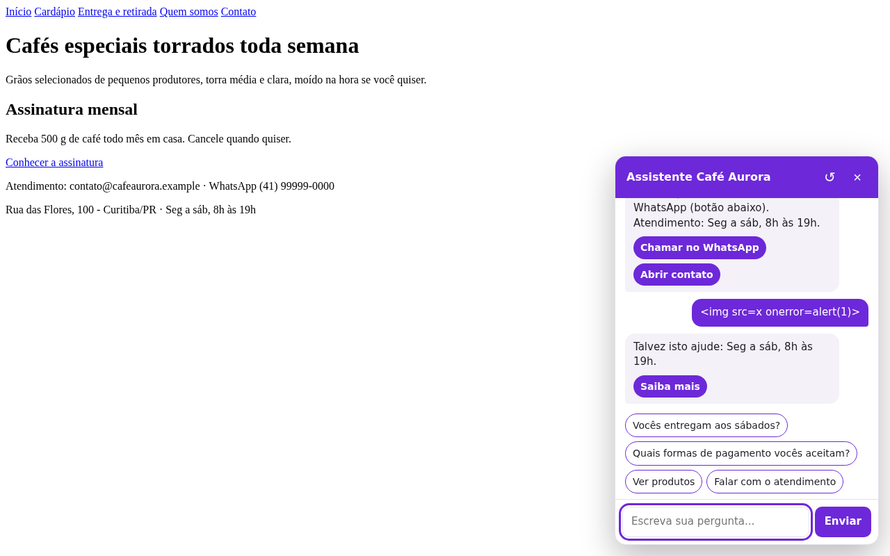

# Agent Generator

Faz um **raio X do seu projeto web** e cria um **agente (chatbot) personalizado** para ele: entende o
que o visitante escreve, responde as perguntas frequentes do site, leva às páginas certas e encontra
produtos ou serviços (inclusive por preço: "até R$ 100").

- **Sem custo e sem IA obrigatória.** O agente roda no navegador do visitante, com processamento
  de linguagem natural local (Naive Bayes e busca por relevância). A IA é opcional e gratuita: serve
  só para *melhorar a base*, nunca para responder em tempo real.
- **Não precisa programar nem treinar do zero.** Um comando lê o projeto, gera a base de
  conhecimento em JSON (editável à mão), instala o widget e mostra a porcentagem de acerto.
- **Funciona com qualquer site:** HTML estático, React, Vite, Next.js, Vue, Nuxt, SvelteKit,
  Angular, Astro, Express, Flask, Django, Laravel...
- **Aprende com você usando o site (0.3):** o executável observa alguns minutos de uso real e,
  na parte 2 (`agente-treinador`), você conversa com o agente no próprio site e corrige cada
  resposta com um clique. Ver [docs/OBSERVAR-E-TREINAR.md](docs/OBSERVAR-E-TREINAR.md).
- **Conversa de verdade e melhora com o uso (0.4):** entende cor, marca, tamanho e categoria do
  seu catálogo ("tem tênis preto da Nike até 300?"), lembra a última lista ("e em azul?", "o mais
  barato", "compara os dois", "me fala do segundo"), guarda as frases que não entendeu (sem dado
  pessoal) e o comando `aprender` sugere onde encaixar cada uma. A base também pode ser editada
  num **editor visual** no navegador. Ver [docs/APRENDER-E-EDITAR.md](docs/APRENDER-E-EDITAR.md).
- **Feito para IAs de código também:** `--json` em todos os comandos e um guia passo a passo
  ([GUIA-PARA-IA.md](GUIA-PARA-IA.md)) para Copilot, Codex, Claude Code, Cursor etc. automatizarem tudo.

O motor de linguagem veio do assistente da loja
[Violet Voltage](https://github.com/AllanRodriguesCosta/violet-voltage-ecommerce), reescrito para
servir a qualquer projeto.

<p align="center"> </p>

## Jeito mais fácil: executável (sem instalar nada)

1. Baixe o executável do seu sistema na página **Releases** (Windows `.exe`, Linux ou macOS).
2. Coloque o arquivo na **pasta raiz do seu site** (onde fica o `index.html` ou o `package.json`).
3. Dê dois cliques e responda sim/não. Ele faz o raio X, cria a base, instala o agente, liga o
   widget nas páginas (guardando cópia dos originais), mostra o acerto e abre o site para testar.

Detalhes, avisos do Windows/macOS e o que ele altera: [docs/EXECUTAVEL.md](docs/EXECUTAVEL.md).
Quem já tem Node e Git pode usar o lançador leve da pasta [`lancadores/`](lancadores).

## Em 1 minuto (com Node)

Requisito: [Node.js](https://nodejs.org) 20 ou mais novo.

```bash
git clone https://github.com/AllanRodriguesCosta/Agent_generator.git
cd Agent_generator
node bin/agent-generator.js criar ../caminho/do/seu-projeto --inserir
node bin/agent-generator.js conversar ../caminho/do/seu-projeto
```

Pronto: o agente aparece no canto da tela das páginas do site. Para ver o exemplo incluído
(cafeteria "Café Aurora"):

```bash
npm run demo          # copia o exemplo para .demo/ e cria o agente nele
npm run demo:servir   # o mesmo e abre http://localhost:5173
```

## Como funciona

```
seu projeto ──► 1. raio X ──► relatorio.json ──► 2. gerar ──► conhecimento/*.json ──► 3. instalar ──► widget no site
                (páginas, rotas,                  (intenções, FAQ,            (núcleo + widget
                 FAQ, catálogo,                    páginas, catálogo)          na pasta pública)
                 contatos)                               ▲
                                                         │ opcional: IA de chat ou Gemini gratuito
                                                         │ acrescenta frases e perguntas (com conferência)
```

1. **Raio X** (`analisar`): lê HTML, JSX/TSX, Vue, Markdown, JSON/CSV e código de rotas. Encontra
   título e descrição do site, páginas e menus, formulários, perguntas frequentes (README,
   `<details>`, JSON-LD FAQPage, títulos com "?"), catálogos (listas de produtos/serviços em
   JSON/CSV ou rota de API) e contatos visíveis (e-mail, WhatsApp, horário). Nunca lê `.env` ou
   chaves, e não altera nada no projeto.
2. **Gerar** (`gerar`): transforma o relatório em 5 arquivos JSON simples. Só usa fatos encontrados;
   textos genéricos (cumprimentar, pedir ajuda, contato) vêm prontos com o nome do site.
3. **Instalar** (`instalar`): copia o núcleo e o widget para a pasta pública (`public/agente`,
   `static/agente` ou `agente/`) e insere a linha do widget nos HTML com `--inserir`.
4. **Avaliar** (`avaliar`): confere se cada pergunta acha a própria resposta e cada página é
   encontrada, e mostra o que errou.

Detalhes do formato: [docs/FORMATO-DA-BASE.md](docs/FORMATO-DA-BASE.md). Arquitetura e decisões:
[docs/COMO-FUNCIONA.md](docs/COMO-FUNCIONA.md).

## Comandos

| Comando | O que faz |
| --- | --- |
| `assistente [pasta]` | Guiado com perguntas sim/não, do raio X ao teste no navegador (é o que o executável roda). `--sim` aceita os padrões |
| `criar <pasta>` | Tudo de uma vez: analisar, gerar, instalar e avaliar |
| `analisar <pasta>` | Só o raio X (`agente-gerador/relatorio.json`) |
| `gerar <pasta>` | Base de conhecimento a partir do relatório (não sobrescreve sem `--forcar`) |
| `instalar <pasta>` | Núcleo e widget na pasta pública; `--inserir` liga nas páginas |
| `avaliar <pasta>` | Porcentagem de acerto e erros (`--frases` com frases próprias) |
| `conversar <pasta> [frases]` | Conversa no terminal (sem frases: modo interativo) |
| `prompt-ia <pasta>` | `agente-gerador/PROMPT-IA.md` para colar no ChatGPT, Gemini, Copilot, DeepSeek... |
| `aplicar-ia <pasta> <arquivo>` | Junta a resposta da IA à base, com conferência e backup |
| `gemini <pasta>` | Igual aos dois acima, automático, com `GEMINI_API_KEY` (plano gratuito) |
| `servir <pasta>` | Servidor local para sites HTML estáticos |
| `observar [pasta]` | Parte 1+: você usa o site por alguns minutos e o agente aprende (páginas reais, formulários, busca, login, catálogo da API, consulta de pedidos). `--url`, `--minutos` |
| `treinar [pasta]` | Parte 2: o site abre com o agente em modo treino; **Certo**/**Corrigir** em cada resposta, inclusive conversas em etapas. É o que o `agente-treinador` roda. Desde a 0.4, as frases não entendidas no site aparecem primeiro |
| `aprender [pasta]` | Agrupa as frases que o agente não entendeu (do servidor ou exportadas do navegador) e sugere onde encaixar; `--aplicar` pergunta grupo a grupo |
| `editar [pasta]` | Editor visual da base no navegador, com teste do rascunho, acerto e salvamento com backup |

Todos aceitam `--json` (saída para scripts e IAs). Também em inglês: `create`, `scan`, `generate`,
`install`, `eval`, `chat`, `ai-prompt`, `ai-apply`, `serve`.

## Para quem vai usar

- **Pessoas:** [TUTORIAL.md](TUTORIAL.md), passo a passo com o que esperar de cada comando.
- **IAs de código e de chat:** [GUIA-PARA-IA.md](GUIA-PARA-IA.md).

## Limites (de propósito)

- É um agente **simples**: responde com o que está na base (agora também com conversas em etapas e
  consultas da conta). Não conversa livremente, não lembra de conversas antigas e não faz compras
  ou cadastros pelo visitante; ele leva às páginas certas.
- O raio X lê o código, não o banco de dados. Catálogo em banco: aponte `catalogo.url` para a
  rota da API que lista os itens (o raio X sugere quando encontra uma).
- Português do Brasil.

Observar e treinar (0.3): [docs/OBSERVAR-E-TREINAR.md](docs/OBSERVAR-E-TREINAR.md).

Próximas melhorias planejadas (raio X do site rodando, entidades, conversa em etapas, ações no
site, aprendizado com o uso, IA só como plano B): [docs/MELHORIAS.md](docs/MELHORIAS.md).

## Desenvolvimento

```bash
npm test            # node --test, sem dependências
npm run build:exe   # gera dist/agente-gerador-<sistema> para o sistema atual (Node 22.12+)
```

Sem dependências de produção. Licença MIT.
