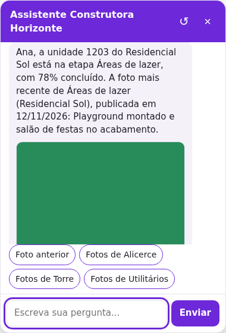

# Fotos no chat, perfil da pessoa logada e conversa mais natural (0.8)



## 1. Galerias de fotos (`midias.json`)

O raio X (e o comando `site`) lê as fotos de conteúdo de cada página e agrupa por **seção**:
o último título `h2`/`h3` antes da foto, ou o atributo `data-etapa`/`data-categoria` da figura.
Logos, ícones, SVG e imagens menores que 80 px ficam de fora.

```html
<h2 id="lazer">Áreas de lazer</h2>
<figure data-etapa="Áreas de lazer">
  
  <figcaption>Playground montado e salão de festas no acabamento</figcaption>
  <time datetime="2026-11-12">12/11/2026</time>
</figure>
```

Data da foto, nesta ordem: `data-data`/`data-date`, `<time datetime>` dentro da figura, data
escrita na legenda (12/11/2026) ou no nome do arquivo (`torre-2026-09-05.jpg`). Sem data, vale
a ordem da página (a última da lista conta como a mais recente).

Formato:

```json
{ "galerias": [
  { "id": "residencial-sol-areas-de-lazer", "titulo": "Áreas de lazer (Residencial Sol)",
    "etapa": "Áreas de lazer", "grupo": "Residencial Sol",
    "link": "/empreendimentos/residencial-sol.html#lazer", "termos": "Piscina... Playground...",
    "itens": [ { "src": "/empreendimentos/img/sol-lazer-b.jpg", "legenda": "Playground montado", "data": "2026-11-12" } ] }
] }
```

O que o agente entende:

| Frase | Resposta |
| --- | --- |
| "última foto da área de lazer do Residencial Sol" | A mais recente daquela etapa e daquele grupo, com a data e a legenda; botão "Ver todas as fotos de Áreas de lazer" (leva à âncora da seção) |
| "foto anterior" / "a próxima" / "a primeira" | Navega na mesma galeria (memória da conversa) |
| "foto de 15/03/2026 do alicerce" | A foto com a data mais próxima |
| "fotos do Residencial Sol" | A foto mais recente de todo o empreendimento |
| "tem fotos da obra?" | Pergunta de qual empreendimento (ou etapa) e mostra botões |
| "fotos da área de lazer do **meu** condomínio" | Com os dados do usuário, escolhe o grupo dele |

Nada é copiado: a resposta só aponta para a imagem que já está no site.

## 2. Perfil da pessoa logada (`perfil.json`)

Respostas sobre os dados **de quem está logado**, por setor (moldes em
[PESQUISA-MERCADO.md](PESQUISA-MERCADO.md#4-o-exemplo-da-construtora-e-as-variações-por-setor)).

```json
{ "ativo": true, "fonte": "/api/minha-unidade", "validadeMin": 15, "pagina": "/entrar.html",
  "apelidos": { "unidade": ["apartamento", "apto"], "previsao": ["previsaoEntrega"] },
  "perguntas": [
    { "id": "andamento_obra", "rotulo": "o andamento da sua obra",
      "exemplos": ["como está a obra do meu apartamento", "em que etapa está meu apartamento"],
      "resposta": "A unidade {unidade} do {empreendimento} está na etapa {etapa}[, com {percentual}% concluído].",
      "midia": "{etapa}", "grupo": "empreendimento" } ] }
```

- `{campo}` procura o campo pelo caminho (`obra.etapa`), pelos apelidos e pelo nome em qualquer
  nível dos dados. Trecho entre `[colchetes]` some se faltar algum campo dele.
- Campo obrigatório faltando: o agente **não inventa**; diz que não encontrou e mostra a página
  da conta.
- `midia` + `grupo`: depois do texto, mostra a foto mais recente da etapa da pessoa, na galeria
  do empreendimento dela.

### De onde vêm os dados (três jeitos; escolha um)

1. **Fonte no próprio site**: `agent-generator perfil <pasta> --fonte /api/minha-unidade`. O
   widget chama esse caminho com o cookie da sessão (ou o token que o site já usa, ver
   `consultas.auth`). 401/403 = não logado → botão "Entrar na conta".
2. **O site entrega depois do login**: `agent-generator perfil <pasta> --ativar` e, no site,
   `agente.identificar({ nome, unidade: {...} })` (ou o evento
   `document.dispatchEvent(new CustomEvent("agente:identificar", { detail: dados }))`). No logout:
   `agente.sair()` ou o evento `agente:sair`.
3. **Página já renderizada com os dados**: `<script type="application/json" id="agente-usuario">{...}</script>`
   ou `window.AGENTE_USUARIO = {...}` antes do widget.

A observação (`agent-generator observar`) também descobre a fonte: se vê uma chamada GET com a
sessão em `/api/me`, `/api/perfil`, `/api/minha-...` e os **nomes** dos campos completam algum
molde, ela grava a fonte e liga o perfil (os valores nunca vão para o relatório).

### Privacidade (regras fixas)

- Os dados ficam só na aba (`sessionStorage`, chave `agente_usuario_v1`) por `validadeMin`
  minutos (padrão 15). Nada vai para `localStorage`, para o registro de faltas, para a IA
  opcional ou para o servidor do agente.
- Campos sensíveis são descartados ao receber: senha, token, CPF/CNPJ/RG, cartão, sessão,
  cookie, hash, JWT.
- No modo servidor/serviço, o servidor responde só "isto é uma pergunta de perfil"; o widget
  completa a resposta localmente com `agent.perfil(id, dados)`.
- `fonte` precisa ser caminho do próprio site (endereço de outro domínio é recusado).

### Testar sem site rodando

```bash
agent-generator perfil ./meu-site --fonte /api/minha-unidade --testar usuario-exemplo.json
```

Mostra a resposta de cada molde com os dados de exemplo e a foto escolhida.

## 3. Conversa mais natural (sem IA)

| Recurso | Exemplo | Configuração |
| --- | --- | --- |
| Várias perguntas numa frase | "qual o horário e vocês aceitam financiamento?" → "Sobre “qual o horário...”: ... E sobre “vocês aceitam financiamento”: ..." | Automático (até 3 partes; só junta se todas tiverem resposta) |
| Tom | Aberturas "Claro!", "Boa pergunta." (amigável) ou "Certamente." (formal), sem repetir seguidas | `agente.json` → `"tom": "amigavel" \| "formal" \| "neutro"` |
| Perguntas relacionadas | Depois de uma resposta da FAQ, 2 perguntas próximas como botões | Automático |
| Empatia | "isso é um absurdo, ninguém responde" → "Sinto muito pelo transtorno. Quero que isso seja resolvido..." + contatos | Desliga com `"tom": "neutro"` |
| Nome | "Oi, Ana!" e "Ana, a unidade 1203..." | Com dados do usuário |
| Digitando | Pontinhos por até 1,2 s, proporcional ao tamanho | `"digitacao": 12` (ms por caractere; 0 desliga) |
| WhatsApp com resumo | O link abre com "Olá! Vim pelo assistente... Minhas dúvidas: ..." | Automático em links wa.me |
