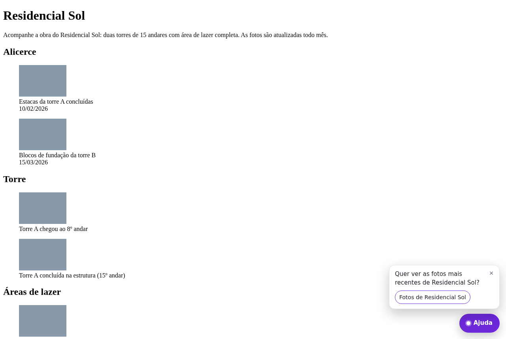
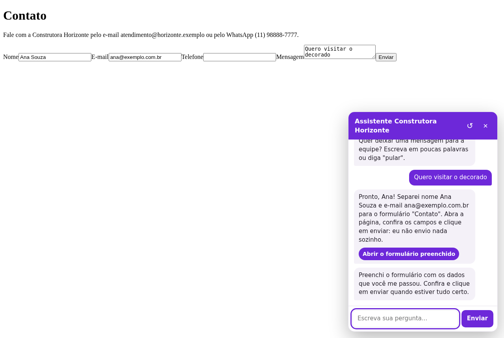
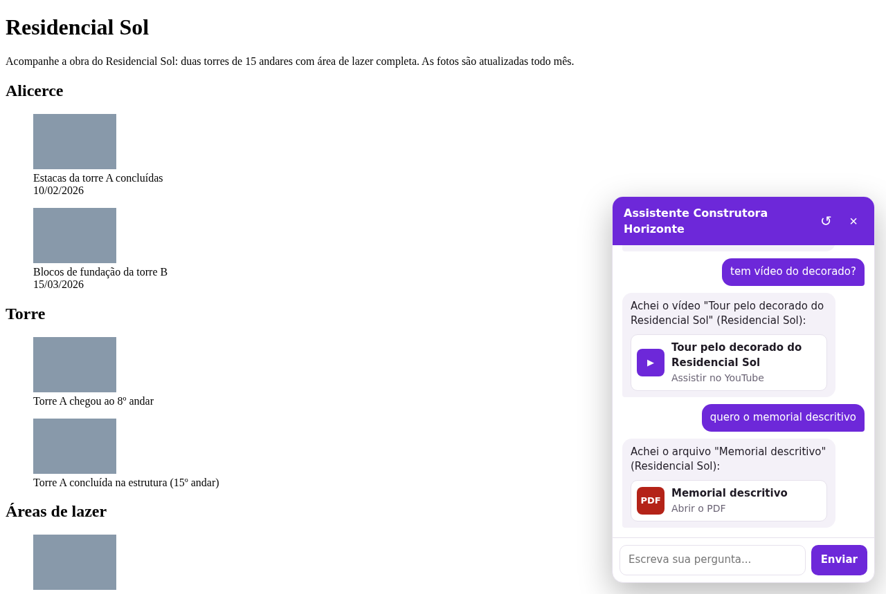

# Conversa guiada e proatividade (0.10)

A 0.10 deixa o agente conduzir a conversa quando falta uma informação, em vez de chutar. Tudo
continua local, gratuito e sem IA obrigatória. A pesquisa por trás de cada item está em
[PESQUISA-AGENTES.md](PESQUISA-AGENTES.md) e [PESQUISA-MERCADO.md](PESQUISA-MERCADO.md).

| # | O que a pessoa vê | Onde fica |
| --- | --- | --- |
| M1 | "Fotos da área de lazer" com dois empreendimentos → **"De qual? Parque Verde ou Residencial Sol"**. A resposta fica guardada: "e a fundação?" já usa o mesmo lugar | `contexto.esclarecer` e `contexto.grupo` |
| M2 | Depois de alguns segundos numa página de obra: **"Quer ver as fotos mais recentes do Residencial Sol?"** (uma vez por sessão) | `agente.json` → `proativas` |
| M3 | "Vocês vendem carro?" numa construtora → **"Isso não é algo que a Construtora oferece"**, em vez de "não entendi" ou de um palpite errado | `setor.json` → `fora` |
| M4 | Busca melhor em textos longos e catálogos grandes (BM25) | `src/agent/search.js` |
| M5 | Antes de levar a uma área com login: **"Para isso você precisa entrar na sua conta. Quer que eu te leve até lá?"** | `contexto.confirmar` |
| M6 | **"Preencher comigo"**: o agente pergunta nome e e-mail/telefone, confere e **deixa o formulário do site preenchido**. A pessoa confere e clica em enviar | `contexto.lead` e `formulario` na resposta |
| M7 | Resposta curta primeiro; **"Explicar melhor"** mostra o resumo maior do conteúdo | `conteudos.json` → `detalhe` |
| M8 | Vídeos (YouTube, Vimeo ou do próprio site) e PDFs (memorial, cardápio, regulamento) aparecem como **cartões** | `midias.json` → `videos`, `arquivos` |
| M9 | Pessoa com duas unidades: **"Você tem 2 unidades: 1203 – Residencial Sol ou 504 – Parque Verde. De qual?"**; "todas" responde cada uma | `perfil.json` (sem mudar o formato) |

## M1: pergunta de esclarecimento

Quando a etapa pedida existe em mais de um grupo (empreendimento, imóvel, destino), o agente
pergunta qual. Dá para responder pelo nome inteiro ou por parte dele ("o do Sol"), pela posição
("a segunda") ou pelo botão. Se a pessoa mudar de assunto, a pergunta é esquecida e a nova frase é
respondida normalmente. O lugar escolhido vale para as perguntas seguintes da conversa.

## M2: mensagem proativa

O gerador cria uma mensagem para cada página com galeria de fotos e para as páginas de orçamento,
agendamento, reserva e inscrição:

```json
"proativas": [
  { "tipo": "fotos", "pagina": "/empreendimentos/residencial-sol.html", "texto": "Quer ver as fotos mais recentes de Residencial Sol?", "sugestoes": ["Fotos de Residencial Sol"], "aposSeg": 20 }
]
```

- Aparece **uma vez por sessão**, só se a conversa ainda não começou e o painel está fechado.
- `aposSeg` (3 a 300) é a espera. `"proativa": false` no `agente.json` desliga todas; no site,
  `window.AGENTE_CONFIG = { proativa: false }` também desliga.
<p align="center"></p>

- Uma mensagem de fotos some quando "Fotos" está desligado no instalador; uma de formulário some
  quando "Formulários" está desligado.

## M3: fora do escopo

`setor.json` ganha `fora`: termos bem típicos dos **outros** setores ("pizza", "dentista") e de
ofertas que nenhum setor cobre ("carro", "celular", "ração"). Tudo o que aparece no próprio site
fica de fora da lista. O agente só usa isso quando:

1. a frase **pede** a coisa ("vendem carro", "tem dentista", "fazem pizza");
2. a base não tem nada forte sobre a frase; e
3. não há uma intenção específica confiante (só "sobre o assistente", "ajuda" e afins perdem
   para ele).

"Tem estacionamento para carro?" **não** é recusado.

## M4: BM25

A ordem dos resultados agora vem do BM25 (k1 = 1,2; b = 0,75): palavra repetida conta mais, com
saturação, e texto comprido é normalizado pelo tamanho. A "cobertura" da frase continua decidindo
se a resposta é forte, então os limiares não mudaram.

## M5: confirmação antes do login

Interação com `requerLogin` responde primeiro com a pergunta e os botões "Sim, vamos" / "Agora
não". Com o "sim", vêm os botões "Ir para ..." e "Entrar na conta". Também foi corrigido um erro
antigo: `/contato.html` era tratado como área logada porque contém "conta".

## M6: captura de contato (funcionalidade "preencher")

Funciona com formulários de orçamento, contato, agendamento, reserva, inscrição, suporte, parceria
e newsletter que peçam **e-mail ou telefone** e não exijam login.

1. A resposta sobre o formulário oferece **"Preencher comigo"** (ou a pessoa diz "me liguem",
   "quero deixar meu contato").
2. O agente pergunta o nome (se o formulário tiver), depois o e-mail ou telefone (confere o
   formato) e, se houver campo de mensagem, uma mensagem curta ("pular" pula).
3. No fim, devolve `formulario: { pagina, valores }` e o botão **"Abrir o formulário
   preenchido"**. O widget guarda os valores **só nesta aba, por 10 minutos**, e preenche os
   campos quando a página abre (ou na hora, se já estiver nela).
4. **Nada é enviado**: a pessoa confere e clica no botão do próprio site.

No modo navegador (padrão) os dados não saem do navegador. No modo servidor (`endpoint`), as
mensagens passam pelo servidor do próprio site, que só grava frases **não entendidas** e já sem
e-mail e telefone (`faltas.jsonl`); os passos da captura não entram nesse registro.

<p align="center"></p>

"Cancelar" interrompe a qualquer momento. Uma pergunta no meio ("qual o horário?") é respondida
normalmente. No instalador, a funcionalidade é a caixa **"Preencher formulários com a pessoa"**
(marcada como sensível). Desligada, o agente só explica o formulário e leva até ele.

O widget acha os campos pelo `type` (`email`, `tel`), pelo `name`, `id`, `placeholder`,
`aria-label`, `autocomplete` e pelo texto do `<label>`. Funciona com React e Vue porque usa o
setter nativo e dispara `input`/`change`.

## M7: curta ou detalhada

O gerador guarda em `conteudos.json` um segundo resumo extrativo (`detalhe`, até 5 frases), só
quando ele acrescenta de verdade. A resposta normal mostra o resumo curto e o botão "Explicar
melhor". Depois de uma FAQ ou de um termo do glossário, "explica melhor" procura um conteúdo
relacionado; se não houver, diz que essa é toda a informação e mostra o contato.

## M8: vídeos e PDFs

O raio X lê `<iframe>` do YouTube/Vimeo, `<video>`, links para vídeos e links para `.pdf`. Cada
item leva a seção da página onde está ("Vídeo e documentos"). No chat, viram cartões que abrem
na plataforma ou no arquivo; nada é incorporado (o site não precisa liberar nada na CSP). A base
recusa vídeo que não seja YouTube, Vimeo ou arquivo de vídeo do próprio site, e arquivo que não
seja PDF. Ficam sob a funcionalidade "Fotos" (agora "Mostrar fotos, vídeos e PDFs no chat").

<p align="center"></p>

## M9: perfil com listas

Se os dados de quem está logado têm uma lista (`unidades`, `pedidos`, `imoveis`...) e o molde fecha
melhor com um item dela, o agente pergunta qual. Responde por item, aceita "todas" e reconhece o
item citado na frase ("a obra do 1203"). O item escolhido vale para as perguntas seguintes. No
modo servidor, a escolha vai no campo `perfil` da resposta (`{ id, item }`) e o widget completa
localmente, como na 0.8: os dados continuam sem ir ao servidor.
