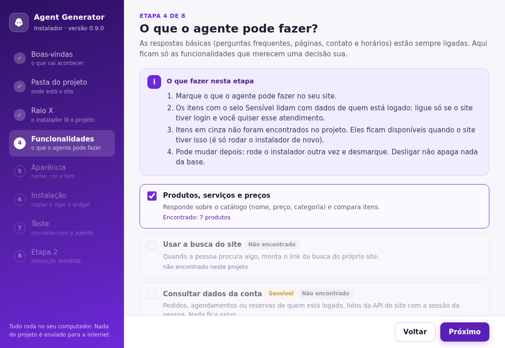
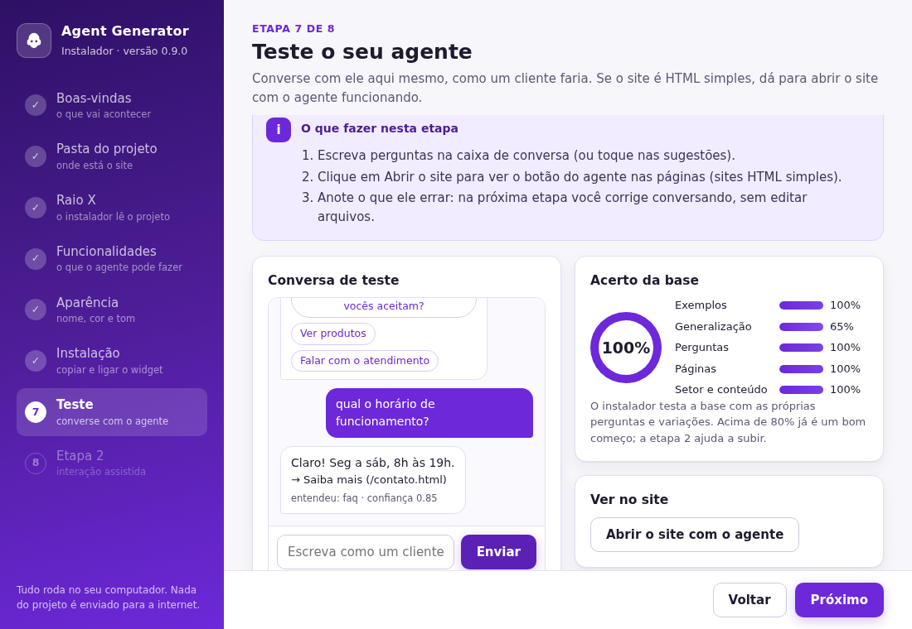
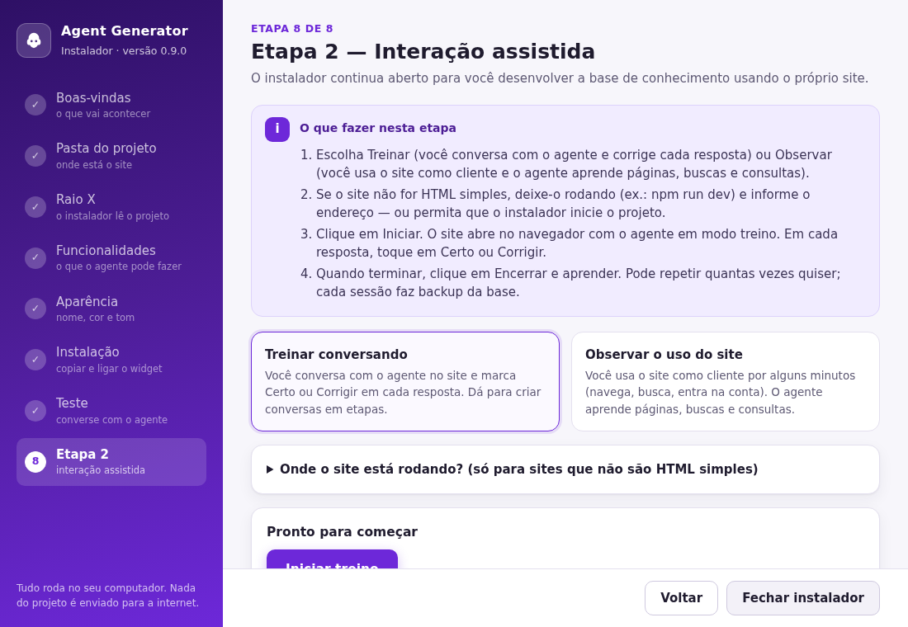
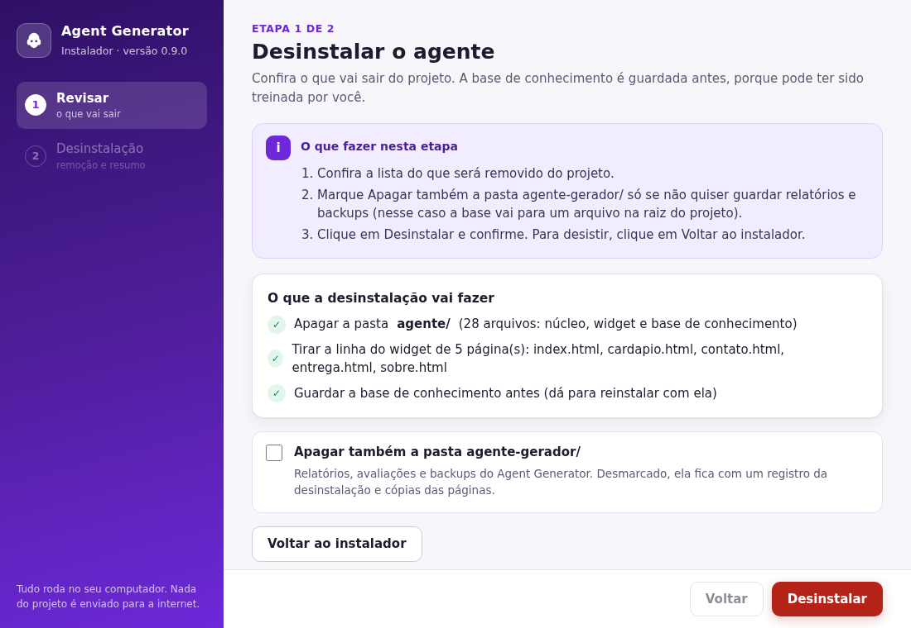

# Instalador visual (0.9): instalar e desinstalar com cliques, sem terminal

> **Novo na 0.11:** caminho **"Meu site já está no ar"** (só o endereço: sem baixar o código e sem
> novo deploy) e etapa **Inteligência artificial** (OpenRouter em 1 clique, Gemini com copiar e
> colar, chave guardada como segredo num serviço seu na Cloudflare). Ver
> [SEM-CODIGO.md](SEM-CODIGO.md).

O `agente-instalador` é o jeito mais fácil de colocar o agente no seu site. Ele abre uma janela
parecida com a de um instalador de programas do Windows: uma lista de etapas à esquerda, as
**instruções do que fazer** em cada etapa no topo e os botões **Voltar** e **Próximo** embaixo.

## Como abrir

1. Baixe o `agente-instalador` do seu sistema na página **Releases** (Windows `.exe`, Linux ou macOS).
2. Coloque o arquivo na **pasta raiz do seu site** (a que tem o `index.html` ou o `package.json`).
3. Dê dois cliques. A janela abre sozinha.
   - **Windows:** na primeira vez pode aparecer "O Windows protegeu o computador" (o arquivo não tem
     assinatura paga). Clique em **Mais informações** e depois em **Executar assim mesmo**. No
     Windows o instalador é um programa de janela: **não abre o terminal**.
   - **macOS/Linux:** veja os avisos em [EXECUTAVEL.md](EXECUTAVEL.md).

A janela é o Edge ou o Chrome em "modo aplicativo" (sem barra de endereço). Sem nenhum dos dois, ela
abre no navegador padrão. Tudo roda no seu computador, num endereço local (`127.0.0.1`) protegido
por um código da sessão: nenhum outro site aberto no navegador consegue usar o instalador.

Com Node: `agent-generator instalador ./meu-site` (ou `npx` a partir do repositório).

## As etapas

Na **Boas-vindas** você escolhe o caminho: **Tenho a pasta do site** (tabela abaixo) ou **Meu site já
está no ar** (endereço, leitura do site, funcionalidades, aparência, inteligência artificial,
publicar, colocar no site e teste — ver [SEM-CODIGO.md](SEM-CODIGO.md)).

| # | Etapa | O que acontece | O que você faz |
| --- | --- | --- | --- |
| 1 | Boas-vindas | Escolha do caminho e resumo do que o instalador vai fazer | Escolhe e clica em Próximo |
| 2 | Pasta do projeto | Confere se é a pasta raiz (✓ `index.html`, ✓ `package.json`, agente já instalado) | Confirma ou cola outro caminho |
| 3 | Raio X | Lê o projeto (só leitura): páginas, rotas, formulários, perguntas frequentes, catálogo e setor | Confere os números; se o setor estiver errado, escolhe outro e refaz |
| 4 | Funcionalidades | Mostra as funcionalidades **que merecem uma decisão**, com o que foi encontrado | Marca ou desmarca os checkboxes |
| 5 | Aparência | Nome, cor do botão, tom, lado da tela e primeira mensagem, com prévia | Ajusta e confere a prévia |
| 6 | Inteligência artificial | (0.11, opcional) Conecta a IA: OpenRouter em 1 clique, Gemini (copiar e colar) ou compatível com OpenAI; publica o serviço da IA na sua conta da Cloudflare | Escolhe Sem IA ou conecta; informa o endereço do site no ar |
| 7 | Instalação | Copia o agente, liga o widget nas páginas (com backup), testa a base e, com IA, publica o serviço | Revisa o resumo e clica em **Instalar** |
| 8 | Teste | Conversa de teste dentro da janela (com a IA, se ligada), acerto da base por área e botão para abrir o site | Conversa como um cliente e anota o que errar |
| 9 | Etapa 2 | **Interação assistida**: treino, observação e editor da base | Treina até ficar bom; a janela continua aberta |

## Funcionalidades (checkbox)

As respostas básicas ficam **sempre ligadas**: perguntas frequentes, páginas, contato, horários,
glossário do setor e resumos dos conteúdos. A lista de checkboxes tem só o que muda o
comportamento do agente de um jeito que você precisa decidir:

| Funcionalidade | Selo | O que faz |
| --- | --- | --- |
| Produtos, serviços e preços | | Responde sobre o catálogo e compara itens |
| Usar a busca do site | | Monta o link da busca do próprio site |
| Consultar dados da conta | **Sensível** | Pedidos, agendamentos ou reservas de quem está logado (lidos da API do site com a sessão da pessoa; nada fica salvo) |
| Respostas com os dados de quem está logado | **Sensível** | Perfil (0.8): "como está a obra do meu apartamento?". Campo opcional com o caminho da API (ex.: `/api/minha-conta`) |
| Explicar formulários e levar até eles | | Agendar, contato, orçamento: diz o que preencher e abre a página. Nunca envia nada |
| Preencher formulários com a pessoa | **Sensível** | (0.10) Pergunta nome e e-mail/telefone na conversa e deixa o formulário do site preenchido; a pessoa confere e envia. Os dados ficam só na aba do navegador |
| Mostrar fotos, vídeos e PDFs no chat | | Galerias por etapa ou categoria; vídeos (YouTube/Vimeo) e PDFs como cartões (0.10) |
| Conversas em etapas | | Perguntas com opções, criadas no treino |

- O que **não foi encontrado** no projeto aparece em cinza, com o selo "Não encontrado".
- As **ações críticas** do site (pagamento, login/senha, cancelar/excluir, dados pessoais) aparecem
  num quadro à parte como **sempre bloqueadas**: o agente nunca envia formulários, faz pagamentos ou
  altera dados. Ele só explica e mostra o caminho.
- A escolha fica em `conhecimento/agente.json`, no campo `recursos`
  (ex.: `"recursos": { "catalogo": false, ... }`). **Desligar não apaga nada da base**: o agente
  só deixa de usar aquela parte. Para religar, rode o instalador de novo ou troque para `true`.

## Etapa 2: interação assistida

Depois de instalar, o instalador **continua aberto** para você desenvolver a base de conhecimento:

- **Treinar conversando:** o site abre no navegador com o agente em modo treino. Converse como um
  cliente e toque em **Certo** ou **Corrigir** em cada resposta. Cada correção vai para a base na
  hora (com backup). A janela do instalador mostra o andamento e, no fim, o acerto antes → depois.
- **Observar o uso do site:** use o site por alguns minutos (navegue, busque, entre na conta). O
  agente aprende páginas, buscas, formulários e consultas da conta.
- **Editor da base:** abre o editor visual (perguntas, intenções, páginas, conversas em etapas).

Site que não é HTML simples (React, Next.js...): deixe-o rodando (`npm run dev`) e informe o
endereço em "Onde o site está rodando?", ou marque **Pode iniciar o projeto com npm run dev**.

Termine no botão **Encerrar e aprender** (ou no "Concluir" da página). Pode repetir quantas vezes
quiser.

 

## Desinstalar

Se o executável encontra, na pasta onde está, um agente criado por ele (a pasta do agente com o
núcleo, o widget e a base, ou páginas com a linha do widget), a primeira etapa mostra **"Já existe
um agente criado pelo Agent Generator neste projeto"** com duas opções: seguir com **Próximo** para
atualizar/reconfigurar (o que você editou é mantido) ou **Desinstalar o agente**.

A desinstalação tem duas etapas, também com as instruções do que fazer:

1. **Revisar:** lista o que vai sair (a pasta do agente e quantos arquivos, as páginas que têm a
   linha do widget) e um checkbox **Apagar também a pasta agente-gerador/** (desmarcado por padrão).
   Clique em **Desinstalar** e confirme.
2. **Desinstalação:** progresso e resumo.

O que ela faz:

- **Guarda a base de conhecimento antes** (ela pode ter sido treinada por você), em
  `agente-gerador/backup/conhecimento-desinstalado-<data>.json`, ou em
  `agente-base-<data>.json` na raiz do projeto se você pediu para apagar `agente-gerador/`.
- **Tira só o bloco que o instalador colocou** nas páginas (o marcador
  `<!-- agente: agent-generator -->` e as duas linhas do widget). A página volta a ser igual à
  original; uma cópia de antes fica em `agente-gerador/backup/html-antes-de-desinstalar/`.
- **Apaga a pasta do agente** só se ela tiver a cara de uma pasta criada pelo instalador
  (`widget.js`, `nucleo/agent.js` e `conhecimento/`) e estiver dentro do projeto. Uma pasta
  `agente/` sua, com outro conteúdo, nunca é apagada.
- Linha do widget **colada à mão** (ex.: no `layout.tsx` do Next.js) não é alterada: aparece no
  resumo como "Linha colada à mão" para você apagar.
- Deixa `agente-gerador/DESINSTALACAO.txt` com o registro (se a pasta ficar).

Pelo terminal: `agent-generator desinstalar ./meu-site` mostra o que vai sair e pede confirmação
(`--sim` confirma sem perguntar, `--tudo` apaga também `agente-gerador/`). O `agente-gerador`
(terminal) também oferece desinstalar quando encontra um agente instalado.

## Fechar

Use **Fechar instalador** na última etapa. Se você só fechar a janela, o instalador encerra sozinho
uns 3 minutos depois (menos durante um treino aberto). Rodar de novo é seguro: a base que você
editou é mantida, a não ser que você marque **Regerar a base do zero** (a anterior vai para
`agente-gerador/backup`).

## O que ele altera no projeto

O mesmo que o assistente de terminal: cria `agente/` (ou `public/agente/`...), a pasta de trabalho
`agente-gerador/` (relatório, avaliação, backups e `RESUMO.txt`) e, se você deixar marcado, uma
linha antes do `</body>` das páginas de entrada, com cópia de cada página em
`agente-gerador/backup/html`.
