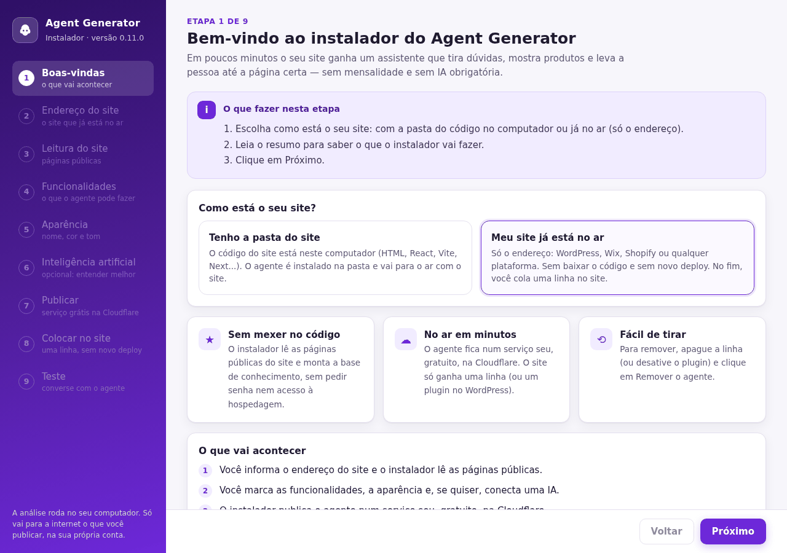
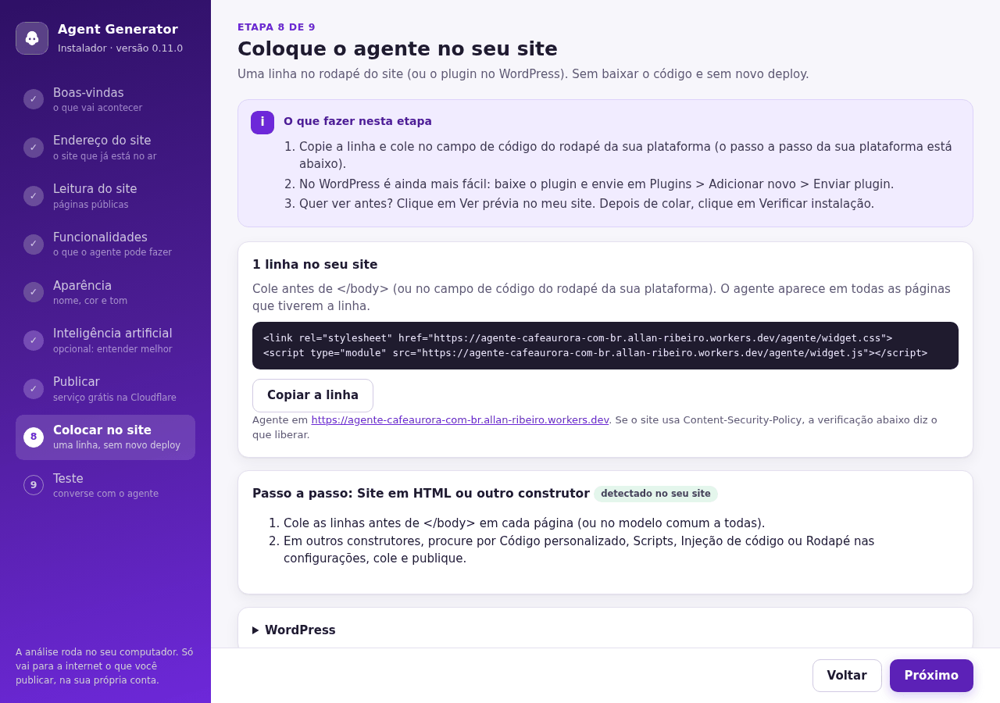
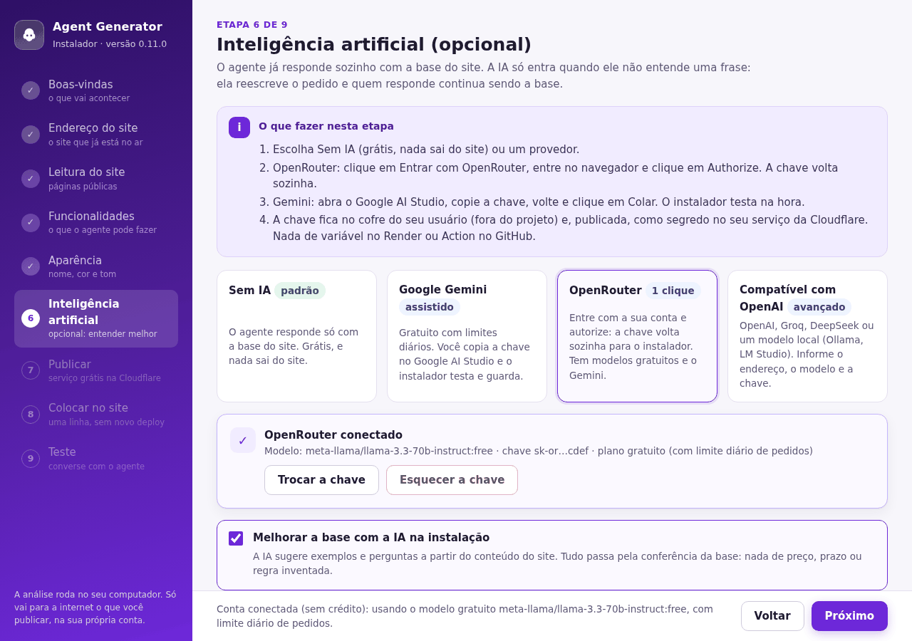
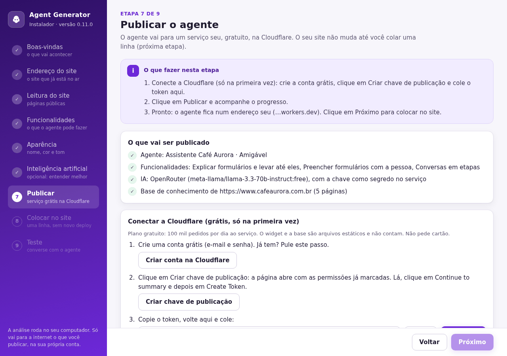

# Sem código (0.11): chave de IA no instalador, serviço do agente e site já publicado

Até a 0.10, colocar o agente no ar pedia três passos técnicos: ter a pasta do site no computador,
publicar o site de novo com o agente e, para usar IA, criar uma variável (`GEMINI_API_KEY`) no
Render ou uma Action no GitHub. A 0.11 tira esses passos do caminho:

1. **A chave da IA é conectada no próprio instalador**, como o Git faz quando abre o navegador para
   você entrar no GitHub. No OpenRouter a chave volta sozinha; no Gemini você copia e cola uma vez.
2. **A chave fica num serviço seu, gratuito, na Cloudflare**, como segredo. O instalador publica o
   serviço pela API: nada de variável no Render, nada de Action no GitHub e nada de chave no código
   do site ou no navegador de quem visita.
3. **Site já publicado (WordPress, Wix, Shopify...)**: basta o endereço. O instalador lê as páginas
   públicas, publica o agente nesse serviço e você cola **uma linha** no site (ou envia um plugin
   no WordPress). Sem baixar o código e sem novo deploy.

<p align="center"></p>

## Para quem não programa: o caminho "Meu site já está no ar"

1. Baixe o `agente-instalador` do seu sistema (Releases) e dê dois cliques. Ele pode ficar em
   qualquer pasta (ex.: Downloads): os arquivos do seu agente vão para a pasta `agente-<seu-site>`
   ao lado dele.
2. Em **Boas-vindas**, escolha **Meu site já está no ar** e clique em Próximo.
3. **Endereço do site**: digite o endereço (ex.: `https://minhaloja.com.br`), confirme que o site é
   seu ou que você tem autorização e clique em **Ler este site**. O instalador lê só páginas
   públicas, respeita o `robots.txt`, nunca entra em login, carrinho ou área do cliente e não envia
   formulários.
4. **Funcionalidades** e **Aparência**: as mesmas telas do instalador da pasta.
5. **Inteligência artificial (opcional)**: veja abaixo. Sem IA, o agente continua completo.
6. **Publicar**: conecte a Cloudflare (só na primeira vez, uns 3 minutos) e clique em **Publicar**.
7. **Colocar no site**: copie a linha e cole no campo de código do rodapé da sua plataforma. O
   instalador mostra o passo a passo da plataforma que ele detectou no seu site. No WordPress,
   baixe o plugin e envie em *Plugins > Adicionar novo > Enviar plugin*.
8. **Ver prévia no meu site** mostra o seu site com o agente antes de colar a linha (é uma cópia
   local; o site de verdade não muda). Depois de colar, **Verificar instalação** confere se a linha
   está na página, se a Content-Security-Policy do site deixa o widget carregar e se o serviço
   responde.

<p align="center"></p>

### Plataformas

| Plataforma | Onde colar |
| --- | --- |
| WordPress | Plugin pronto (`agente-wordpress.zip`): Plugins > Adicionar novo > Enviar plugin > Ativar. Ou o plugin WPCode (Header & Footer > Footer) |
| Wix | Configurações > Avançado > Código personalizado > Todas as páginas > Corpo - fim (planos com domínio conectado) |
| Shopify | Loja virtual > Temas > Editar código > `layout/theme.liquid`, antes de `</body>` |
| Webflow | Configurações do site > Código personalizado > Footer code, e publicar |
| Squarespace | Configurações > Avançado > Injeção de código > Rodapé (planos Business e Commerce) |
| Google Tag Manager | Tag HTML personalizado com o **carregador** (versão para GTM), acionador All Pages |
| Blogger | Layout > Adicionar um gadget > HTML/JavaScript |
| HTML ou outro construtor | Antes de `</body>` em cada página, ou no campo "código personalizado/scripts/rodapé" |

O passo a passo também fica em `agente-<site>/agente-gerador/COMO-COLOCAR-NO-SITE.txt`.

### Atualizar e remover

- **Editar a base** e **Publicar de novo** (etapa Teste): o site não precisa ser publicado de novo,
  porque o agente mora no serviço.
- **Reler o site** (conteúdo novo): abra o instalador, escolha o mesmo endereço e refaça a
  leitura. O que você editou na base é mantido; páginas e catálogo são atualizados.
- **Remover**: apague a linha do site (ou desative o plugin) e clique em **Remover o agente**
  (etapa Colocar no site). O serviço é apagado da sua conta da Cloudflare.

## A chave da IA no instalador

A etapa **Inteligência artificial** existe nos dois caminhos (pasta e site publicado). A IA só entra
quando o agente não entende uma frase: ela **reescreve** o pedido com o vocabulário do site e quem
responde continua sendo a base. Nunca inventa preço, prazo ou política.

<p align="center"></p>

| Provedor | Como a chave chega | Custo |
| --- | --- | --- |
| **OpenRouter** (1 clique) | **Entrar com OpenRouter** abre o login no navegador. Você entra (dá para usar a conta Google) e clica em **Authorize**: o OpenRouter devolve a chave para o instalador, sozinho. | Conta sem crédito usa modelos gratuitos, com limite diário de pedidos. Com crédito, usa o Gemini e outros. |
| **Google Gemini** (assistido) | **Abrir o Google AI Studio** abre a página das chaves (conta nova já ganha uma). Copie, volte e clique em **Colar**: o instalador testa na hora. | Gratuito com limites diários. |
| **Compatível com OpenAI** (avançado) | Endereço da API, modelo e chave (Groq, OpenAI, DeepSeek, Ollama/LM Studio locais). | Depende do provedor. |

### Como funciona o "1 clique" do OpenRouter

É o mesmo desenho do login do Git e de ferramentas de linha de comando: o instalador abre um
endereço de retorno **só no seu computador** (`http://127.0.0.1:<porta>/openrouter/retorno`), abre o
login do OpenRouter com esse retorno e espera. Quando você autoriza, o OpenRouter manda um código
para o retorno e o instalador troca o código pela chave. O código sozinho não vale nada (PKCE: só
o instalador tem o verificador). Não é preciso cadastrar aplicativo nem ter senha guardada.

### Por que o Gemini ainda é "copiar e colar"

Gerar a chave do Gemini sem a pessoa copiar exigiria o login do Google com permissão para mexer no
Google Cloud da pessoa (criar projeto, conta de serviço e chave). Para um programa distribuído a
qualquer pessoa, o Google exige um aplicativo OAuth **verificado** (com site, política de privacidade
e revisão) e, desde maio/2026, as chaves novas do AI Studio são "chaves de autorização" ligadas a uma
conta de serviço, o que acrescenta passos e permissões. Automatizar a página do AI Studio com um
script seria frágil e contra os termos de uso. Hoje, copiar e colar leva menos de um minuto; o
caminho 100% automático ficou no roadmap (pesquisa R1), depois da landing page.

### Onde a chave fica

- **No seu computador:** no cofre do seu usuário, fora do projeto e do git
  (`%APPDATA%\agent-generator\cofre.json` no Windows, `~/Library/Application Support/agent-generator/`
  no macOS, `~/.config/agent-generator/` no Linux), legível só pelo seu usuário. A janela e o
  terminal mostram só o começo e o fim da chave (`sk-or…cdef`). **Esquecer a chave** apaga do cofre.
- **No serviço do agente:** como **segredo** da Cloudflare (criptografado; ninguém lê de volta,
  nem pelo painel).
- **Nunca** no projeto, no `agente.json`, no widget, no navegador de quem visita ou no log.

## O serviço do agente na Cloudflare

A Cloudflare tem um plano **gratuito** de Workers: 100 mil pedidos por dia ao serviço, sem cartão.
O instalador publica pela API, na **sua** conta:

| Modo | Quando | O que vai para o serviço |
| --- | --- | --- |
| **ia** | Pasta do projeto com IA | Só a IA: a chave (segredo) e o vocabulário do site. O agente continua no site e chama `…/api/ia` só quando não entende. |
| **completo** | Site já publicado | O widget, o núcleo e a base como **arquivos estáticos** (servidos pela Cloudflare sem contar no limite diário) e a IA (opcional). |

Em todos os modos o serviço tem:

- `POST /api/ia` — recebe só a frase que o agente do navegador não entendeu (sem e-mail, telefone,
  documentos ou códigos: viram marcadores antes de sair) e devolve a pergunta reescrita.
- `GET /saude` — estado (sem segredos).
- **Origem conferida**: só o seu site (com e sem `www.`) usa o serviço; na pasta do projeto também
  `localhost`, para testar no computador.
- **Limites**: 6 frases por minuto por visitante, 8 por minuto e 300 por dia de IA (por servidor da
  Cloudflare). Protegem a cota gratuita da sua chave.
- **Frases não entendidas** guardadas por 90 dias (Workers KV, sem dado pessoal), lidas pelo comando
  `aprender` para você ensinar o agente.

### Conectar a Cloudflare (só na primeira vez)

<p align="center"></p>

1. **Criar conta na Cloudflare** (e-mail e senha). Já tem? Pule.
2. **Criar chave de publicação**: abre a página de tokens com as permissões **já marcadas**
   (*Workers Scripts: Edit*, *Workers KV Storage: Edit*, *Account Settings: Read*). Clique em
   *Continue to summary* e *Create Token*.
3. Copie o token, volte e clique em **Colar**. O instalador confere o token e guarda no cofre.

Conta nova ainda não tem o endereço gratuito `*.workers.dev`: o instalador cria na primeira
publicação (com o nome da conta). Esse endereço novo pode levar alguns minutos para responder.

## Pasta do projeto: IA sem variável no Render

No caminho **Tenho a pasta do site**, a etapa Inteligência artificial mostra **Onde a chave fica**:
marque **Publicar o serviço da IA na Cloudflare**, informe o endereço do site no ar (para liberar o
domínio) e conecte a Cloudflare. Na instalação, o instalador publica o serviço e grava no
`agente.json` só o endereço dele:

```json
"ia": { "endpoint": "https://agente-minhaloja-com-br.sua-conta.workers.dev/api/ia" }
```

Publique o site uma vez com o agente (como antes). Depois disso, **trocar a chave ou o provedor é só
rodar o instalador de novo**: o endereço do serviço não muda e o site não precisa de novo deploy.

## Pelo terminal

```bash
# 1. Conectar a IA (uma vez). OpenRouter: abre o navegador e a chave volta sozinha.
agent-generator ia --provedor openrouter
GEMINI_API_KEY=... agent-generator ia --provedor gemini      # ou --chave <chave>
agent-generator ia                                            # mostra o que está conectado
agent-generator ia --esquecer=tudo                            # apaga o cofre

# 2a. Pasta do projeto: publica a IA e liga o widget ao serviço.
agent-generator publicar ./meu-site --token <token-da-cloudflare> --site https://minhaloja.com.br

# 2b. Site já publicado: lê o site e publica o agente inteiro (mostra a linha, o guia e o plugin).
agent-generator site https://minhaloja.com.br ./agente-minhaloja --sim
agent-generator publicar ./agente-minhaloja --token <token-da-cloudflare>   # --token só na 1ª vez

# Frases que o serviço guardou -> sugestões de onde encaixar.
agent-generator aprender ./agente-minhaloja

# Remover o serviço.
agent-generator publicar ./agente-minhaloja --remover
```

O token só é pedido uma vez (fica no cofre). `--json` funciona em `ia` e `publicar`.

## Limites e cuidados

- **Content-Security-Policy**: se o site bloqueia scripts de outros endereços, a verificação diz o
  que acrescentar (`script-src`, `style-src` e `connect-src` com o endereço do serviço).
- **Sites montados só por JavaScript**: a leitura pela janela usa o HTML que o servidor entrega.
  Para esses sites, use `site <url> --navegador` no terminal (precisa do Playwright).
- **Áreas com login** (pedidos, perfil): só funcionam quando o widget roda no próprio site e o site
  tem as APIs; num site de plataforma fechada, o agente fica com o conteúdo público.
- **Rede da empresa**: proxies e firewalls corporativos podem bloquear a Cloudflare, o OpenRouter
  ou o Google. Faça a conexão numa rede comum.
- **Use só em sites seus** ou com autorização (a janela pede a confirmação).
- O caminho antigo continua: a pasta `agente-servico/` gerada pelo comando `site` vai para o Render,
  Docker ou qualquer servidor com Node 20 ([SITE-PUBLICADO.md](SITE-PUBLICADO.md)).
